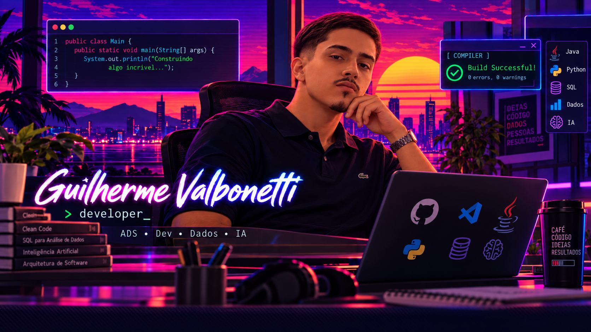

---

## 👨‍💻 Sobre mim

Sou o **Guilherme**, tenho 21 anos, curso **Análise e Desenvolvimento de Sistemas na PUC Minas** e atuo como **estagiário de Sistemas Corporativos na Prefeitura Municipal de Contagem**.

Gosto de desenvolver soluções completas, desde a modelagem do banco de dados e a construção de APIs até a criação das interfaces. Tenho interesse em **desenvolvimento de software, dados e inteligência artificial**, e busco colocar em prática o que aprendo por meio de projetos acadêmicos e desafios de tecnologia.

Já trabalhei com **React, Next.js, Node.js, SQL Server e PostgreSQL**, além de explorar o desenvolvimento mobile com **React Native** e desenvolver funcionalidades com **Python e Flask**.

---

## 🔭 Atualmente

- 🎓 Cursando o **4º período de Análise e Desenvolvimento de Sistemas** na PUC Minas.
- 💼 Atuando em **Sistemas Corporativos** na Prefeitura Municipal de Contagem.
- 🌱 Desenvolvendo o **PlantAI**, aplicativo que utiliza IA para auxiliar na identificação de doenças e pragas em plantas.
- 📚 Aprimorando meus conhecimentos em **Java, React, Python, banco de dados e desenvolvimento de APIs**.
- 🚀 Buscando evoluir profissionalmente nas áreas de **Desenvolvimento e Dados**.

---

## 🚀 Projetos

### 💰 PoupeMais `Full Stack`
> Sistema de controle financeiro pessoal com cadastro de transações, histórico financeiro, gráficos, simulações e autenticação com verificação por e-mail. Desenvolvido como projeto interdisciplinar na PUC Minas.
>
> 🏆 **Premiado como Melhor Trabalho Interdisciplinar do 2º período — PUC Minas Barreiro.**

`HTML` `CSS` `JavaScript` `Bootstrap` `Node.js` `Express` `SQL Server`

---

### 🌱 PlantAI `Mobile + IA`
> Aplicativo mobile que utiliza inteligência artificial para analisar imagens de plantas, identificar possíveis doenças e pragas e apresentar recomendações. Projeto desenvolvido com integração entre aplicativo, API e banco de dados.

`React Native` `Expo` `TypeScript` `Node.js` `Express` `PostgreSQL` `IA`

---

### 🏋️ FitHub `Desenvolvimento Web`
> Projeto de plataforma fitness com interfaces para clientes e profissionais, incluindo personal trainers e nutricionistas. Desenvolvido com foco em autenticação, gerenciamento de perfis e organização das funcionalidades do sistema.
>
> 🏆 **Premiado como Melhor Trabalho Interdisciplinar do 3º período — PUC Minas Barreiro.**

`Next.js` `React` `TypeScript` `CSS Modules`

---

## 🛠️ Tech Stack

<table align="center">
  <tr>
    <td align="center" width="50%">
      <h4>🎨 Frontend</h4>
      
    </td>
    <td align="center" width="50%">
      <h4>⚙️ Backend</h4>
      
    </td>
  </tr>
  <tr>
    <td align="center" width="50%">
      <h4>📱 Mobile</h4>
      
      
React Native · Expo

    </td>
    <td align="center" width="50%">
      <h4>🗄️ Banco de Dados</h4>
      
       
      
    </td>
  </tr>
  <tr>
    <td align="center" width="50%">
      <h4>🔧 Ferramentas</h4>
      
    </td>
    <td align="center" width="50%">
      <h4>📋 Gestão e Modelagem</h4>
      
Jira · Bizagi · Miro

    </td>
  </tr>
</table>

---

## 💼 Experiência

**Estagiário de Sistemas Corporativos · Prefeitura Municipal de Contagem** *(mai/2026 – atual)*

- Desenvolvimento e manutenção de **formulários HTML** para serviços e processos internos, incluindo demandas integradas ao **SEI**.
- Participação em atividades de **desenvolvimento web**, com estudos e colaboração em interfaces utilizando **React**.
- Atuação em funcionalidade de **CRUD com Python e Flask**, envolvendo gerenciamento de tipos de perfis e exclusão lógica (*soft delete*).
- Utilização do **Figma** para apoiar a prototipação e a organização visual de interfaces.
- Apoio à **análise de requisitos, ajustes e homologação de formulários** conforme as demandas das áreas solicitantes.
- Elaboração de **relatórios, atas e documentação técnica** e apoio a rotinas de governança de TI.
- Participação em iniciativas de **melhoria e digitalização de processos** da Prefeitura.

---

## 🎓 Formação 

-  **Tecnólogo em Análise e Desenvolvimento de Sistemas** — PUC Minas *(previsão de conclusão: dez/2027)*.

---

## 📊 Estatísticas

---

### 🚀 Em constante evolução

Aberto a oportunidades e novos desafios nas áreas de **Desenvolvimento de Software e Dados**. Gosto de aprender, colaborar e transformar ideias em soluções reais.

 

